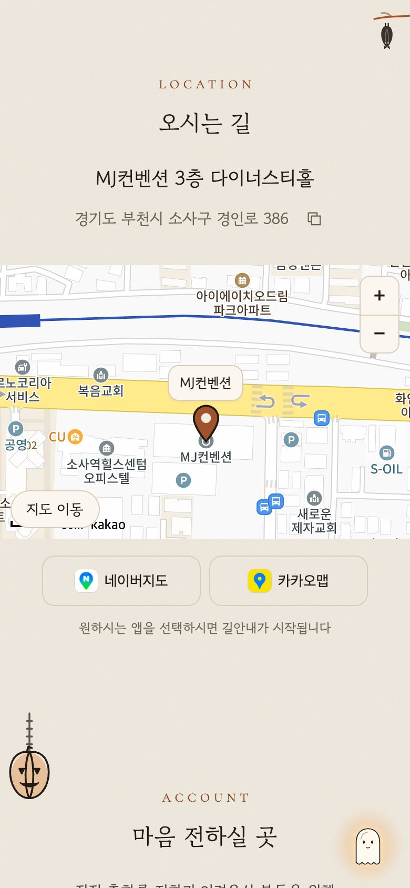
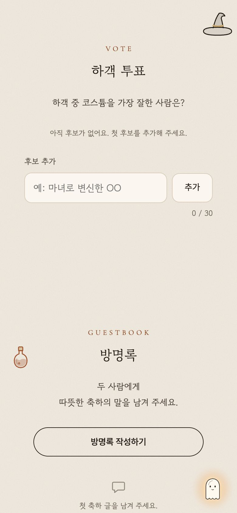

# 모바일 청첩장

- 고민혁 & 김은정 결혼식 모바일 청첩장 (2027-10-31 10:30, MJ컨벤션 부천)
- [데모 사이트](https://teddko.github.io/wedding/)
- 현재 공개 테마: Halloween 1종 (`noindex,nofollow` 메타로 검색 노출 차단)


<p align="center">
  <a href="https://teddko.github.io/wedding/"></a>
  <a href="https://teddko.github.io/wedding/"></a>
  <a href="https://teddko.github.io/wedding/"></a>
  <a href="https://teddko.github.io/wedding/"></a>
</p>
<p align="center">인트로 · 커버 · 오시는 길 · 투표와 방명록 (모바일 390px, 이미지 클릭 시 데모 사이트 이동)</p>

## 저장소 구조 (pnpm workspaces 모노레포)

```
apps/web         @wedding/web     Astro 7 정적 사이트 + Svelte 5 아일랜드 (GitHub Pages)
apps/api         @wedding/api     Cloudflare Worker: Hono + Drizzle(D1) + R2
packages/shared  @wedding/shared  웹·API 공용 상수, 에러 코드, zod 스키마와 타입
```

- 패키지 매니저 pnpm 11 단일 lockfile, Node 24(`.nvmrc`, 최소 22.23.4)
- 포맷·린트 Biome, 타입 검사 TypeScript strict(`tsconfig.base.json`)
- 웹은 `@wedding/shared` 의 타입·상수만 사용(zod 미포함 번들), API 는 같은 스키마로 요청 검증
- 이미지: sharp 로 빌드 시 webp 반응형 변환
- 배포: GitHub Pages(웹, `main` push 자동), wrangler(API, 수동)
- 보안 정책과 위협 모델: [SECURITY.md](SECURITY.md)

## 개발

```sh
corepack pnpm install
cp apps/web/.env.example apps/web/.env   # 최초 1회, 값 입력
corepack pnpm dev        # 웹 http://localhost:4321/wedding/
corepack pnpm dev:api    # API http://localhost:8787 (wrangler dev --local --env dev)
corepack pnpm test       # shared + API vitest(Workers 런타임, 로컬 D1/R2)
corepack pnpm typecheck  # 전 패키지 타입 검사
corepack pnpm build      # astro check + astro build -> apps/web/dist/
```

### 빌드 변수

| 이름 | 용도 | 누락 시 |
|---|---|---|
| `PUBLIC_API_URL` | Worker 주소(방명록, 스냅샷, 투표 공용) | 빌드 실패 |
| `PUBLIC_KAKAO_JS_KEY` | 카카오 JavaScript 키(공개 키) | 빌드 실패 |
| `PUBLIC_SNAPSHOTS_CDN` | 스냅샷 이미지 R2 공개 주소(끝 슬래시 없음) | Worker `/p/:uuid/:kind` 로 로드 |

- 로컬: `apps/web/.env`(git 제외). 로컬 API 사용 시 `PUBLIC_API_URL=http://localhost:8787`
- CI·배포: GitHub 저장소 Settings > Secrets and variables > Actions > Variables
- 전부 브라우저 번들에 노출되는 공개값. 비밀값 등록 금지(비밀값은 Worker 시크릿 전용)

## 페이지 구성 (위에서 아래 순서)

인트로 게이트 > 커버 > 인사말 > 갤러리 > 스냅샷 > 오시는 길 > 계좌 > 참석 여부 > 투표 > 축하 글 > 엔딩

- 콘텐츠는 서버 HTML 에 모두 포함, 아일랜드는 연출과 인터랙션만 담당. JS 없이도 이름, 날짜, 장소, 인사말, 링크 확인 가능
- 값이 비어 있는 섹션(계좌, 참석, 투표, 축하 글, 스냅샷)은 통째로 숨김

## 내용 수정

모든 문구와 값은 `apps/web/src/data/wedding.ts` 한 곳에서 관리함.

| 필드 | 설명 |
|---|---|
| `groom` / `bride` | `{ name, relation, givenName?, father, mother }`. 부모는 `{ name, deceased }`, `deceased: true` 는 故 표기. 부모 이름이 모두 비면 혼주 줄 숨김. 이름 분리가 어긋나는 두 글자 성은 `givenName` 직접 지정 |
| `theme` | 기본 테마 키 |
| `cover.focus` | 커버 사진 `object-position` (기본 `50% 35%`) |
| `date` / `time` / `timezone` | 날짜와 시간. 공유 문구를 뺀 전부 자동 반영 |
| `venue` | 장소명, 홀, 주소, 좌표, `mapQuery`, 교통 안내(`transit`, 비면 생략) |
| `greeting` | 인사말 제목과 본문 배열 (TODO 문구 교체 필요) |
| `accounts` | 신랑측/신부측 `{ role, bank, number, holder, payLink? }`. 번호가 비면 "준비 중", 부모 이름과 번호가 모두 비면 행 숨김, 항목 0개면 섹션 숨김 |
| `rsvpUrl` | 구글폼 주소. 비면 섹션 숨김 |
| `guestbookApi` / `snapshotsApi` | `PUBLIC_API_URL` 주입값 |
| `snapshotsCdn` | `PUBLIC_SNAPSHOTS_CDN` 주입값. CDN 로드 실패 시 Worker 주소로 1회 재시도 |
| `poll.question` | 투표 질문. 비면 섹션 숨김. 항목은 하객이 직접 추가 |
| `kakaoJsKey` | `PUBLIC_KAKAO_JS_KEY` 주입값. REST 키와 네이티브 키는 프런트 사용 금지 |
| `share` | 카카오 공유 제목과 설명, `copyUrl`(링크 복사 버튼이 복사하는 단축 주소, 비면 페이지 주소) |
| `musicCredit` | 배경음악 출처. 트랙이 있을 때만 푸터 표시 |

### 사진

- `apps/web/src/assets/photos/` 에 jpg/png/webp 를 넣으면 파일명 순으로 자동 사용
- 첫 장은 커버(4:5), 전체는 갤러리와 라이트박스에 사용
- 폴더가 비어 있으면 `apps/web/src/assets/mock/<테마>/` 의 목업 사진 세트로 대체(템플릿 미리보기용). 실제 사진을 넣는 순간 목업은 사라짐

### 배경음악

1. `public/audio/bgm.mp3` 배치 (없으면 음소거 버튼도 숨김)
2. 같은 폴더 `LICENSE.txt` 에 출처 기록
3. `musicCredit` 값 맞춤

## 테마 정책

- 방문자에게 열린 테마는 `apps/web/src/lib/themes.ts` 의 `THEME_NAMES` 에 있는 키만 해당. 현재 `["halloween"]` 하나라서 테마 전환 버튼과 인트로 선택지는 숨김
- `dev` (프로그래머), `puppy` (강아지) 코드와 토큰은 유지 중
- 다시 열기: `THEME_NAMES` 에 키 추가(예: `["halloween", "dev", "puppy"]`). 2개 이상이면 전환 버튼과 인트로 선택지 자동 표시, `?theme=dev` 쿼리와 localStorage 선택도 다시 동작
- 새 테마 추가: `THEMES` 에 키 추가 + `apps/web/src/styles/global.css` 의 `[data-theme]` 토큰 블록 추가
- 모션 감소(`prefers-reduced-motion`) 환경에서는 모든 연출이 정적 상태로 표시

## 기능

- 인트로 게이트: 이름과 날짜 타이포 + 초대장 열기. 탭 시 페이드아웃, 배경음악 시작. JS 가 꺼져 있거나 4.5초 안에 로드 실패 시 자동 해제
- 커버(Halloween): 촛불, 바구니, 유령이 포인터를 따라다니는 연출 + 드레스코드 팝업
- 섹션 장난감: 거미, 고양이, 부엉이, 박쥐, 랜턴, 모자, 물약, 거미줄(탭 연출)
- 갤러리: FLIP 라이트박스(스와이프, 핀치, 관성, 방향키, Esc), 모바일 뒤로가기 버튼으로 라이트박스 닫기
- 스냅샷(하객 사진 업로드)
  - 클라이언트 압축은 Web Worker 에서 처리, HEIC 는 `heic-to` 지연 로드 청크로 대체 디코드
  - 업로드 전 확인 다이얼로그에서 삭제 비밀번호 입력(선택)
  - 캐러셀은 30장 단위 페이징
  - 라이트박스 삭제: 비밀번호를 정한 사진은 어느 기기든 비밀번호 필요, 비밀번호 없는 사진은 올린 기기에서만 가능
  - 삭제 비밀번호 입력값은 업로드·삭제 완료나 취소 시 즉시 비움
  - 이미지는 R2 공개 주소에서 직접 로드(Worker 요청 절감), 실패 시 Worker 로 재시도
- 투표: 결과는 누구나 열람(45초 주기 갱신), 투표와 항목 추가는 카카오 로그인 후 1인 1표(변경 불가). 항목 30자, 최대 20개, 1인 2개. 로그인 토큰은 sessionStorage 보관(탭 종료 시 소멸)
- 축하 글(방명록): 최신 5개 + 무한 스크롤, 접기, 작성, 비밀번호 삭제
- 오시는 길: 카카오맵 임베드(이동 잠금 토글, 8초 내 로드 실패 시 주소 카드로 대체) + 길찾기 앱 버튼(네이버지도, 티맵, 카카오맵, 공식 아이콘, 플랫폼별 딥링크)
- 계좌: 신랑측/신부측 탭, 복사 버튼, 송금 링크
- 공유: 링크 복사(`share.copyUrl`), 카카오톡 공유
- 배경음악 토글, 맨 위로 버튼
- 모바일과 태블릿 확대 잠금(`apps/web/src/scripts/zoom.ts`). PC 는 제외, 라이트박스와 지도는 자체 줌 사용

## 백엔드

Cloudflare Worker `wedding-guestbook` 하나가 방명록, 스냅샷(R2 `wedding-snapshots`), 투표(카카오 로그인)를 처리함. 구조, 엔드포인트, 데이터 모델, 제한, 보안, 무료 플랜 예산, 배포 명령은 [apps/api/README.md](apps/api/README.md) 참고.

## CI·배포 흐름

- `.github/workflows/ci.yml`: push·PR 시 Biome, 타입 검사, API 테스트, 웹 빌드, `pnpm audit --audit-level high`
- `.github/workflows/deploy.yml`: `main` push(웹 관련 경로 변경) 시 GitHub Pages 배포, 수동 실행은 `workflow_dispatch`
- 액션은 커밋 SHA 고정, Dependabot 주간 갱신(npm 14일 쿨다운)

순서

1. API 변경 시 Worker 먼저: `apps/api/` 에서 `wrangler d1 migrations apply wedding-guestbook --remote` 후 `wrangler deploy`
2. 실서버 확인(조회 200, CORS·보안 헤더)
3. `main` push 로 웹 배포
4. 문제 시 `wrangler rollback <버전 ID>` (스키마 변경은 이전 버전과 호환 유지)

## 운영 메모

- 무료 플랜 기준 설계: Workers 하루 100k 요청·요청당 CPU 10ms, D1 하루 읽기 5M 행·쓰기 100k 행, R2 10GB. 세부 예산과 실측은 [apps/api/README.md](apps/api/README.md#무료-플랜-예산)
- 스냅샷 이미지는 R2 공개 주소(r2.dev)에서 직접 로드. Cloudflare 안내상 r2.dev 는 운영 비권장(초당 수백 건 초과 시 429), 실패 시 Worker 로 재시도
- 숨김과 삭제 후에도 브라우저 캐시(immutable 1년)에 이미지가 남을 수 있음
- 관리자 토큰(`ADMIN_TOKEN`)은 macOS 키체인 서비스 `wedding-admin-token` 에만 보관. 저장소 기록 금지

### 카카오 콘솔 체크리스트

1. [플랫폼 키] > [JavaScript 키] > [JavaScript SDK 도메인] 에 `https://teddko.github.io` 등록 (공유, 지도, 투표 로그인 공통)
2. [제품 설정] > [카카오맵] > [사용 설정] 상태 ON
3. [카카오 로그인] 활성화 + Redirect URI `https://teddko.github.io/wedding/` 등록
4. 클라이언트 시크릿 활성화 (Worker 시크릿 `KAKAO_CLIENT_SECRET` 과 짝)
5. 공유 SDK 버전과 SRI 해시는 `apps/web/src/components/ActionButtons.svelte` 에 고정. 버전 변경 시 해시 재계산

```sh
curl -s https://t1.kakaocdn.net/kakao_js_sdk/<ver>/kakao.min.js | openssl dgst -sha384 -binary | openssl base64 -A
```

### 테스트 데이터 정리

`apps/api/` 에서 실행.

```sh
# 투표 초기화
wrangler d1 execute wedding-guestbook --remote --command "DELETE FROM poll_votes; DELETE FROM poll_options"
# 스냅샷 행 초기화 (R2 객체는 별도 삭제 필요)
wrangler d1 execute wedding-guestbook --remote --command "DELETE FROM photos; DELETE FROM uploads"
```

- 스냅샷 개별 정리는 관리자 토큰으로 `DELETE /photos/:uuid` 호출 (R2 객체까지 삭제, `?hide=1` 은 숨김만)
- 투표 항목 개별 숨김은 관리자 토큰으로 `DELETE /poll/options/:id` 호출
- R2 객체 일괄 삭제는 Cloudflare 대시보드 또는 `wrangler r2 object delete wedding-snapshots/<key> --remote`
